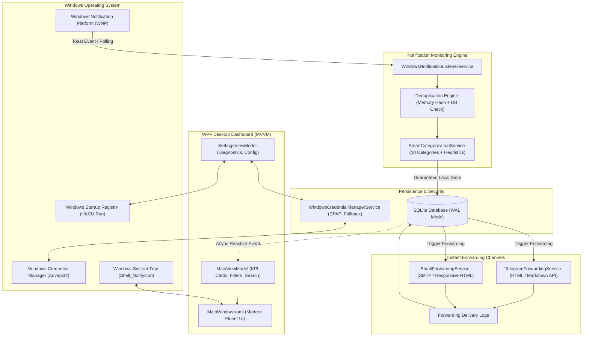

# Notify Hub — Architecture Blueprint & Technical Design

## 1. Architectural Overview

Notify Hub is built as a high-performance native Windows desktop application following Clean Architecture and MVVM (Model-View-ViewModel) design principles. The system operates on .NET 9 and Windows 10/11 WinRT APIs, designed to run continuously and unobtrusively in the background.



---

## 2. Core Subsystems

### 2.1 Notification Monitoring Engine
- **Class:** `WindowsNotificationListenerService` (`INotificationListenerService`)
- **Technology:** WinRT `Windows.UI.Notifications.Management.UserNotificationListener`
- **Execution Model:**
  - Real-time subscription to `listener.NotificationChanged` (fires on `Added` kind).
  - Background synchronization timer running every 3.5 seconds to capture any events that Windows may drop during thread switching or system wake-up.
  - Multi-tier deduplication prevents duplicate processing of the same notification.
  - Excluded application filtering allows users to suppress unwanted application streams.

### 2.2 Local SQLite Persistence Engine
- **Class:** `SqliteDatabaseService` (`IDatabaseService`)
- **Technology:** `Microsoft.Data.Sqlite`
- **Concurrency & Reliability:**
  - WAL Journal Mode (`PRAGMA journal_mode=WAL;`) provides concurrent reading and writing without database locks.
  - Synchronous mode set to `NORMAL` ensures ACID guarantees without disk I/O bottlenecks.
  - All operations use parameterized queries to completely prevent SQL injection.
  - Database schema includes optimized indexes on `ReceivedAt DESC`, `Status`, `Category`, `AppName`, and unique index on `NotificationId`.

### 2.3 Smart Categorization & Priority Engine
- **Class:** `SmartCategorizationService` (`ICategorizationService`)
- **Rules Model:**
  - User-defined and pre-seeded rules are evaluated in priority order.
  - Supports 6 match algorithms: `AppNameEquals`, `AppNameContains`, `TitleContains`, `BodyContains`, `ContentContains`, `RegexMatch`.
  - Fallback offline heuristics classify notifications into 10 default categories:
    1. *Work & Business*
    2. *Emails*
    3. *Messages & Communication*
    4. *Social Media*
    5. *Finance & Banking*
    6. *System & Security*
    7. *Calendar & Reminders*
    8. *Shopping & Orders*
    9. *Personal*
    10. *Other*
  - Priority determination heuristics automatically detect OTPs, fraud alerts, security threats, and server alarms, escalating them to `Urgent` or `High` priority.

### 2.4 Instant Forwarding Engine
- **Classes:** `TelegramForwardingService`, `EmailForwardingService`
- **Key Requirement Guarantee:**
  - Forwarding is executed **asynchronously after the notification is committed to SQLite**.
  - A network outage, Telegram rate limit, or invalid SMTP server **never blocks notification capture and never causes data loss**.
  - Exponential backoff retry policy (3 automatic retries).
  - Failed deliveries are permanently recorded in the `ForwardingLogs` table and can be manually retried with one click from the dashboard.

### 2.5 Security & Windows Credential Manager
- **Class:** `WindowsCredentialManagerService` (`ISecureStorageService`)
- **Implementation:**
  - Interacts directly with Windows Credential Manager via P/Invoke (`Advapi32.dll` functions: `CredWriteW`, `CredReadW`, `CredDeleteW`, `CredFree`).
  - Sensitive tokens (Telegram Bot Token, SMTP Password) are stored under the target names `NotifyHub_TelegramBotToken` and `NotifyHub_SmtpPassword`.
  - Zero plaintext passwords or tokens are stored in the SQLite database or configuration files.
  - DPAPI (`ProtectedData.Protect` / `Unprotect` with `CurrentUser` scope) acts as an automated secondary fallback.

---

## 3. Database Schema

```sql
-- Core Notifications Table
CREATE TABLE Notifications (
    Id INTEGER PRIMARY KEY AUTOINCREMENT,
    NotificationId TEXT NOT NULL UNIQUE,
    AppName TEXT NOT NULL,
    AppId TEXT,
    Title TEXT,
    Body TEXT,
    Category TEXT NOT NULL,
    ReceivedAt TEXT NOT NULL,
    Status INTEGER NOT NULL DEFAULT 0,
    Priority INTEGER NOT NULL DEFAULT 1,
    UserNotes TEXT,
    LastUpdatedAt TEXT NOT NULL,
    ForwardingStatus INTEGER NOT NULL DEFAULT 0,
    RawMetadata TEXT
);

CREATE INDEX IX_Notifications_ReceivedAt ON Notifications(ReceivedAt DESC);
CREATE INDEX IX_Notifications_Status ON Notifications(Status);
CREATE INDEX IX_Notifications_Category ON Notifications(Category);
CREATE INDEX IX_Notifications_AppName ON Notifications(AppName);

-- Categories Table
CREATE TABLE Categories (
    Id INTEGER PRIMARY KEY AUTOINCREMENT,
    Name TEXT NOT NULL UNIQUE,
    Description TEXT,
    IconGlyph TEXT,
    ColorHex TEXT,
    IsSystem INTEGER NOT NULL DEFAULT 0
);

-- Categorization Rules Table
CREATE TABLE CategoryRules (
    Id INTEGER PRIMARY KEY AUTOINCREMENT,
    CategoryName TEXT NOT NULL,
    MatchType INTEGER NOT NULL DEFAULT 0,
    Pattern TEXT NOT NULL,
    Priority INTEGER NOT NULL DEFAULT 10,
    IsActive INTEGER NOT NULL DEFAULT 1
);

-- Forwarding Delivery Logs Table
CREATE TABLE ForwardingLogs (
    Id INTEGER PRIMARY KEY AUTOINCREMENT,
    NotificationId INTEGER NOT NULL,
    AppName TEXT,
    NotificationTitle TEXT,
    DestinationType INTEGER NOT NULL,
    Status TEXT NOT NULL,
    AttemptCount INTEGER NOT NULL DEFAULT 1,
    Timestamp TEXT NOT NULL,
    ErrorDetails TEXT
);

CREATE INDEX IX_ForwardingLogs_NotificationId ON ForwardingLogs(NotificationId);
CREATE INDEX IX_ForwardingLogs_Timestamp ON ForwardingLogs(Timestamp DESC);
```
